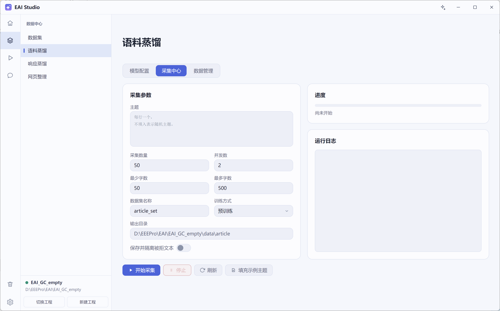
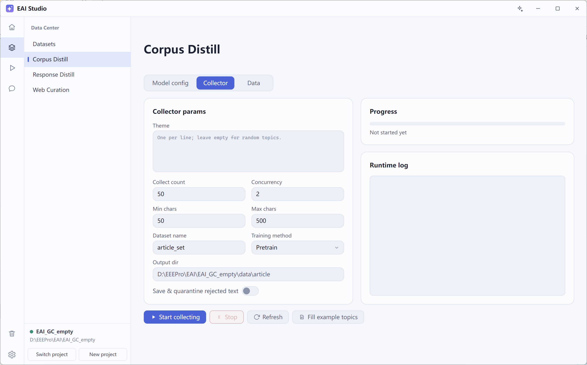
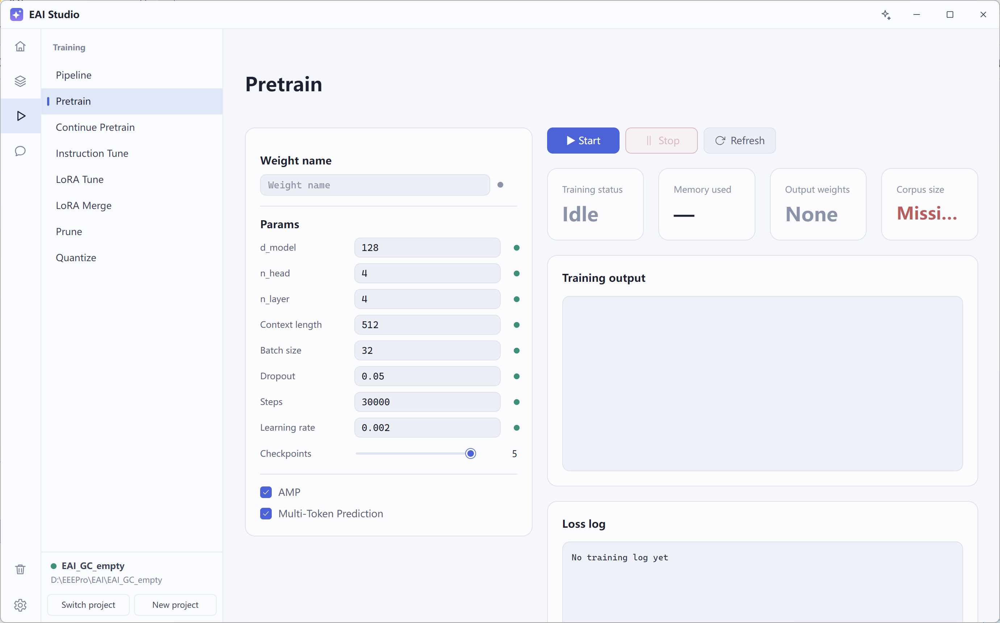

# EAI Studio

**在本地，把你的语料变成能用的模型。**

EAI Studio 是一个 Windows 桌面应用，把大模型微调的整条链路收进一个窗口：从网页和对话里收集语料、整理成训练集、在自己显卡上训练、随时对话验证、满意后导出交付。

数据、权重、训练过程都留在本机；除了你自己配置的云端模型接口，软件不会把任何东西发到外面。

  
  
  

你可以用它做这些事：

- **攒语料** —— 内置「选题 → 写作 → 审阅」多模型协作机制，给个主题就能产出干净的语料；也能把网页正文整理成文本，或者生成问答对做指令微调数据。
- **管数据** —— 数据集导入、标注、合并、锁定，删除进回收站；一个工程一个文件夹，随时整体备份或搬到别的机器。
- **训模型** —— 预训练、继续预训练、指令微调、LoRA 微调都在本机显卡上跑；多个训练步骤可以排成流水线，点一次按顺序跑完。
- **管权重** —— 训练产物（权重、LoRA、检查点）在仓库里以卡片呈现，带训练方式、大小、来源和锁定状态，可以搜索、按日期筛、删除进回收站。
- **验模型** —— 内置对话页直接加载本地模型，可以挂不同的 LoRA 对比效果；满意了再转换格式、导出交付。
- **看得清** —— 训练进度、损失曲线、运行日志都在界面里，出问题有日志可查，不用翻命令行。

开始用：解压后双击 `启动.bat`。第一次会引导你把运行环境装好（点一次「开始安装」），装完自动进入主界面；以后每次双击直接打开。界面中文 / English 随时切换，首次安装需要联网，之后可以完全离线使用。

此版本为XPU版本。

---

# EAI Studio

**Turn your own corpus into a usable model — locally.**

EAI Studio is a Windows desktop app that puts the whole fine-tuning loop in one window: collect text from the web and from conversations, shape it into training sets, train on your own GPU, chat with the result, and export it when you are happy.

Your data, weights and training runs stay on your machine; nothing leaves the computer unless you configure a cloud model API yourself.

  
  
  

What you can do with it:

- **Build a corpus** — a built-in topic → writing → review multi-model collaboration mechanism turns a subject into clean training text; it can also clean web page bodies, or generate question/answer pairs for instruction tuning.
- **Keep your data in order** — import, label, merge and lock datasets, with a recycle bin for anything you delete; one folder per project, easy to back up or move to another machine.
- **Train on your own hardware** — pretraining, continued pretraining, instruction tuning and LoRA all run on the local GPU; several steps can be queued into a pipeline and run in order with one click.
- **Track every weight** — training outputs (weights, LoRAs, checkpoints) appear as cards with training type, size, source and lock state; searchable, filterable by date, deletable to the recycle bin.
- **Try before you ship** — a built-in chat page loads local models and lets you swap LoRAs to compare results, then convert the format and export.
- **See what is happening** — progress, loss curves and runtime logs live inside the app, so problems are visible without digging through terminals.

Getting started: extract the archive and double-click `启动.bat`. The first launch walks you through the runtime install (one click on "Install"), then opens the main window; later launches go straight in. The UI switches between Chinese and English at any time, and the first install is the only step that needs a network connection.

This is the XPU edition.

---

Licensed under the MIT License.
